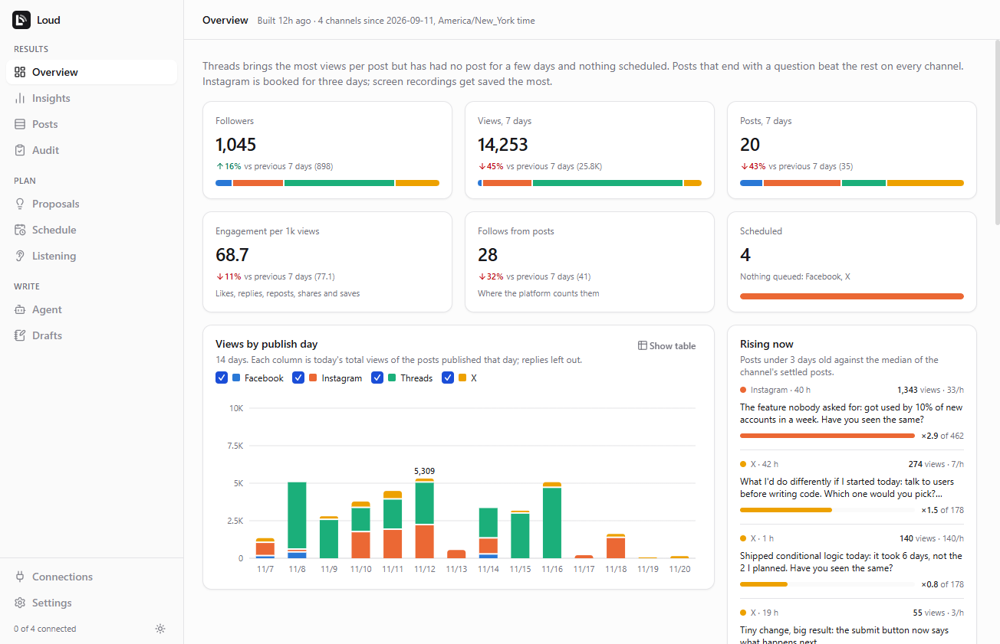
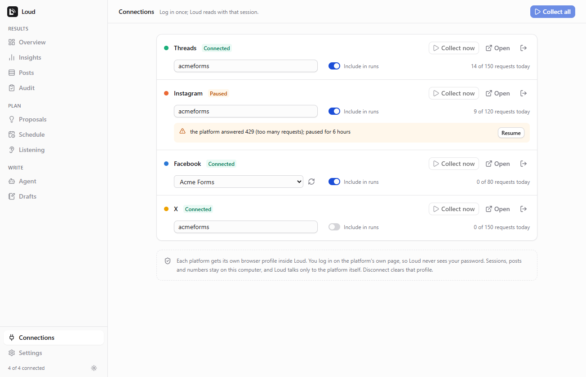

# Loud

**Try something loud.** A desktop app for people who build things and forget to tell anyone. Connect your social accounts once; Loud keeps an eye on what you post and how it lands, and helps you plan what to post next.

Part of [Try Something](https://trysometh.ing). Home: [loud.trysometh.ing](https://loud.trysometh.ing).



<sub>Demo data: "Acme Forms" is fictional.</sub>

> [!NOTE]
> Loud is early. The dashboard, drafts and the agent work and are checked with the fictional demo data. The collectors are written but have not yet been run against the real platforms; expect them to need fixes. See [Status](#status).

## How it works

- **Log in once, on the platform's own page.** Each platform (Threads, Instagram, Facebook, X) gets its own browser profile inside Loud. You sign in the way you always do, so Loud never sees your password, and one login never leaks into another site.
- **Your data stays on your computer.** Sessions, posts and numbers live in Loud's profile folder. Loud talks to the platforms you connected and to nothing else, unless you turn on the agent, update checks or usage reports, and Settings says where each goes.
- **Usage reports only if you say yes.** On first launch Loud asks whether to send one small report a day to loud.trysometh.ing: version, OS, which platforms are connected, and how many collection runs worked or failed. Never a handle, a post or a number from your accounts. Settings shows the exact report; turning it off deletes what was sent. Every field is listed on the [privacy page](https://loud.trysometh.ing/privacy), and the totals are [public](https://loud.trysometh.ing/#numbers).
- **Gentle on your accounts.** Collection reads at a human pace, with daily caps, pauses for hours after a "too many requests", and stops at the first checkpoint or captcha rather than push through it.
- **An agent if you want one.** Turn it on in Settings and it reads your numbers through Loud's own tools, proposes posts and writes drafts. It runs through Claude Code or Codex, signed in on your computer, so what it reads goes to Anthropic or OpenAI. It cannot post; you do.



## Status

| Area                                                                  | State                                                                                           |
| --------------------------------------------------------------------- | ----------------------------------------------------------------------------------------------- |
| Connections: per-platform profiles, login detection, handle detection | Working                                                                                         |
| Today, Posts, Insights, Plan, Listening                               | Working; checked with demo data                                                                 |
| Build (analytics) in TypeScript                                       | Working; tested                                                                                 |
| Collectors with rate limits, timer and tray                           | Written and unit-tested on fictional fixtures; **not yet run against the real platforms**       |
| Agent (Claude Code, Codex) and Drafts                                 | Working with demo data; off until you turn it on                                                |
| Installers and updates                                                | Configured; Windows build tried locally, unsigned. Update checks are off until you turn them on |
| Scheduled posting through official APIs                               | Later                                                                                           |

## Develop

Needs Node 22.12+ and pnpm.

```sh
pnpm install
pnpm dev          # builds the dashboard, then starts the app
```

Run from source, Loud keeps its profile in a separate `Loud Dev` folder, never the installed app's. For a throwaway profile with the fictional demo:

```sh
LOUD_HOME=/tmp/loud-home LOUD_DEMO=1 pnpm dev
```

`LOUD_DEMO=1` fills an empty data folder with the Acme Forms demo. `pnpm --filter @loud/desktop demo <folder>` writes it to any folder for `LOUD_DATA`.

### The agent

Install and sign in to Claude Code or Codex the usual way; Loud finds it on your `PATH`. Then turn the agent on in Settings. Loud stores no model key. What the agent reads (posts, numbers, drafts, listening results), what you type and the files you attach are sent to that provider.

Chats are saved in the profile and listed beside the conversation. The composer picks the CLI, model and reasoning effort (a chat keeps the CLI it started on), takes images and text files, and shows the plan limits of the signed-in account as each CLI reports them.

| Variable         | What it does                                                                                                                       |
| ---------------- | ---------------------------------------------------------------------------------------------------------------------------------- |
| `LOUD_HOME`      | Moves the whole profile: settings and browser sessions. Without it, a copy run from source uses `Loud Dev` in the app-data folder. |
| `LOUD_DATA`      | Moves only the data folder the dashboard reads.                                                                                    |
| `LOUD_DEMO`      | `1` fills an empty data folder with the fictional demo.                                                                            |
| `LOUD_SHOT`      | Saves a screenshot of the dashboard to this path, then quits (`LOUD_SHOT_JS`, `LOUD_SHOT_WAIT` to set it up). From source only.    |
| `LOUD_USAGE_URL` | Sends usage reports to this test server instead; without it, a copy run from source sends none.                                    |

Checks: `pnpm typecheck`, `pnpm test`, `pnpm build`, `pnpm check:repo`. Installers: `pnpm --filter @loud/desktop dist`; see [docs/releasing.md](docs/releasing.md).

## Layout

```
apps/desktop       Electron main process (Effect services): platform sessions, collectors, build, agent, IPC
apps/web           The dashboard: React, Tailwind, Base UI
packages/contracts Effect Schema types shared by both sides
packages/shared    Analytics, time stamps and post length, used by the desktop and the dashboard
docs/              Architecture, data format, platform notes, releasing
```

More in [docs/architecture.md](docs/architecture.md).

## Contributing

See [CONTRIBUTING.md](CONTRIBUTING.md) and [AGENTS.md](AGENTS.md). Security reports: [SECURITY.md](SECURITY.md).

## License

[MIT](LICENSE) for the code. The Loud and Try Something names and logos are not covered by it; see [TRADEMARK.md](TRADEMARK.md). The UI primitives in `apps/web/src/components/ui` are adapted from [T3 Code](https://github.com/pingdotgg/t3code) (MIT).
